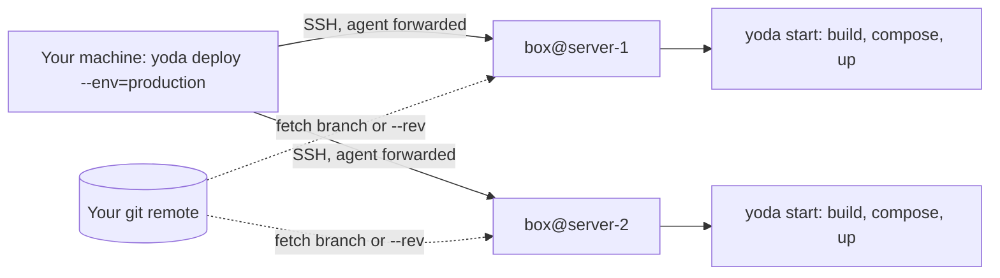

# Yoda

[](https://github.com/Muvon/yoda/actions/workflows/ci.yml)
[](https://github.com/Muvon/yoda/releases)
[](https://github.com/Muvon/homebrew-tap)
[](#prerequisites)
[](#prerequisites)
[](LICENSE)

> Dockerize any project and deploy it to your servers — with pure Bash.


Yoda turns a git repository into a Docker setup that you can run on your machine and ship to one server or many over SSH. It adds a `docker/` folder to your project, builds your images, writes one Compose file per environment, starts containers in the order you choose, and deploys to all servers in parallel. One command rolls back.

There is no agent, no daemon and no control plane. Yoda is a set of Bash scripts on top of `git`, `ssh` and `docker compose`, and you can read all of it in an afternoon.

**Contents:**
[Why Yoda](#why-yoda) ·
[How it works](#how-it-works) ·
[Installation](#installation) ·
[Quick start](#quick-start) ·
[Deploy to servers](#deploy-to-servers) ·
[Configuration](#configuration) ·
[CLI reference](#cli-reference) ·
[Recipes](#recipes) ·
[Troubleshooting](#troubleshooting) ·
[Security notes](#security-notes) ·
[Development](#development)

## Why Yoda?

- **Few dependencies.** You need Bash, git, SSH and Docker with the Compose plugin. No agent or daemon runs on your servers.
- **Environments built in.** Use `dev`, `production` or any other name. Each one can have its own env file and its own Compose overrides.
- **Many servers in parallel.** One `Envfile` maps hosts to environments and stacks. `yoda deploy` runs on every node at once and reports each result.
- **Rollback built in.** Each deploy records its revision on the server. `yoda rollback` redeploys the one before it.
- **Ordered starts.** A `Startfile` can stop services first, start others in chunks, and wait for one-shot jobs such as migrations.
- **Scale from one template.** `web=4` creates four containers from one definition.
- **Hooks at every stage.** Put an executable `build`, `compose`, `start`, `stop`, `destroy` or `deploy` script in `docker/` to wrap or replace that step.
- **Tested.** CI runs ShellCheck and a Bats test suite on Linux and macOS.

### Is Yoda the right tool?

Yoda fits well when:

- you run a few VMs or bare-metal servers and want repeatable, git-driven deploys without Kubernetes or a PaaS;
- you already work with Docker Compose and want environments, scaling and multi-host deploys on top of it;
- you want a deploy tool small enough to read and change yourself.

Choose something else if you need:

- scheduling across a cluster, self-healing or autoscaling (Kubernetes, Nomad, Swarm);
- zero-downtime rolling deploys out of the box. Yoda recreates changed containers in place. You can [replace containers one by one](#replace-containers-one-by-one) by hand;
- load balancing, TLS termination or secret management. Bring your own tools for these.

## How it works



On your machine, `yoda start` does three things:

1. It writes `docker/docker-compose.<env>.yml` from your container templates.
2. It builds the images listed in `Buildfile`, tagged with the current commit.
3. It runs `docker compose up`.

`yoda deploy` runs that same `yoda start` on each server, inside a fresh checkout of your repository. [FLOW.md](FLOW.md) describes each stage in detail.

## Installation

### Prerequisites

| Requirement | Version | Notes |
|---|---|---|
| Bash | 4.0+ | macOS ships Bash 3.2: `brew install bash` |
| Docker Engine | API 1.41+ (Docker 20.10+) | |
| Docker Compose plugin | v2 (`docker compose`) | Yoda does not use the old `docker-compose` binary |
| Git | 2.22+ | |
| GNU sed | — | macOS: `brew install gnu-sed` |

`make check` checks the versions of Bash, Docker, Compose and Git. Yoda refuses to run as `root`. Use a regular user that can talk to Docker.

### From source (recommended)

```bash
git clone https://github.com/Muvon/yoda.git
cd yoda && make check && sudo make install
```

`make install` creates a symlink from `/usr/local/bin/yoda` to `yoda` in the clone. To update Yoda, run `git pull` in the clone. To uninstall, remove the symlink and the clone.

### Homebrew

```bash
brew install muvon/tap/yoda
```

Homebrew installs the release tarball, not a git checkout. Local work and deploys both work. Only automatic switching to a project's pinned Yoda version needs a git clone. Without one, Yoda warns and runs the installed version.

Check the install:

```bash
yoda version   # prints the installed version, e.g. Yoda version: 2.6.0
```

### Version pinning

`yoda init` writes the current Yoda version into `docker/.yodarc`. If you run a different Yoda version in that project, Yoda checks out the project's version tag in its own git clone and runs the command again. If it cannot switch, for example with a Homebrew install or a missing tag, it prints a warning and continues with the installed version. Run `yoda upgrade` in the `dev` environment to move a project to the version you have installed. On servers, deploys use this same mechanism to run the project's pinned version.

## Quick start

This example serves your project's files with Python. It takes about two minutes and needs only Docker.

**1. Create the skeleton.** Run Yoda from your project root, which should be a git repository:

```bash
yoda init       # creates docker/
yoda add web    # creates docker/containers/web/ and adds web to the dev environment
```

**2. Describe the image** in `docker/images/Dockerfile-base`:

```dockerfile
FROM python:3.12-alpine
COPY . /src
```

**3. Tell the container what to run** in `docker/containers/web/entrypoint`:

```sh
#!/usr/bin/env sh
exec python -m http.server 8088
```

**4. Publish a port.** Append these lines to `docker/containers/web/container.yml`:

```yaml
ports:
  - "8088:8088"
```

**5. Start it:**

```bash
yoda start --wait     # build the image, write the Compose file, start web
curl localhost:8088   # lists your project files
yoda status           # docker compose ps
yoda log -f web       # follow the logs
yoda destroy          # remove the containers, networks and volumes
```

Images are tagged with the short commit hash, or `latest` before your first commit. If the tag already exists, Yoda skips the build. After you change code without making a new commit, run `yoda start --rebuild`.

## Deploy to servers

### 1. Describe your servers

Add your hosts to `docker/Envfile`:

```yaml
box@203.0.113.10: production
production: web=2 worker
dev: web worker
```

### 2. Prepare the servers

A server needs Docker with the Compose plugin, git and Bash 4+. The SSH user from the `Envfile` must be allowed to run Docker, and it must not be `root`.

On a fresh **Rocky Linux 9/10, CentOS Stream 9 or CentOS 8** server, Yoda can do this for you. You need root SSH access with a key:

```bash
cp ~/.ssh/id_ed25519.pub docker/.ssh/authorized_keys   # docker/.ssh is git-ignored
yoda setup --env=production
```

This changes system configuration and reboots the server. Read [what setup changes](#security-notes) before you run it. On other distributions, prepare the servers by hand.

### 3. Deploy

Before you deploy, push your branch. Each server checks out `origin/<branch>`, so commits that are only on your machine are not deployed. Your SSH key must be loaded in your agent (`ssh-add`), because the servers use it to clone your repository.

```bash
yoda deploy --env=production
```

Yoda deploys to every matching node in parallel and shows a live status for each one:

```text
Nodes: 2
Logs: /path/to/project/docker/log
Started: Sat Oct 24 07:20:40 UTC 2026
Elapsed: 41 s
box@203.0.113.10 – succeed
box@203.0.113.11 – failed
Finished: Sat Oct 24 07:21:21 UTC 2026
box@203.0.113.11 log:
  ...last 5 lines of docker/log/box_203.0.113.11.log...
```

The command exits with `0` only if every node succeeds. This makes it safe to use in CI.

On each server, a deploy does the following:

1. On the first deploy, it clones Yoda into `~/.yoda` and your project into `~/.deploy/<project>`.
2. It fetches, checks out the branch and runs `git reset --hard origin/<branch>`. With `--rev`, it checks out that revision instead.
3. It runs `git clean -fdx`, which removes every file that git does not track.
4. It runs `ENV=<env> STACK=<stack> yoda start`.
5. It appends the deployed revision to `~/.deploy/<project>.revision`.

### Choosing targets

| Command | Deploys to |
|---|---|
| `yoda deploy --env=production` | every host in `production`, all stacks included |
| `yoda deploy --env=production --stack=front` | only hosts in `production.front` |
| `yoda deploy --host=203.0.113.10` | hosts that match the regular expression |
| `yoda deploy --env=production --rev=2.1.0` | a specific tag or commit |
| `yoda deploy --env=production --branch=release` | the head of another branch |
| `yoda deploy --env=production --args="WORKERS=8"` | as usual, and passes `WORKERS=8` to `yoda start` on each node |

### Rollback

```bash
yoda rollback --env=production               # the previous revision on every node
yoda rollback --env=production --rev=abc1234 # a specific revision
```

Without `--rev`, Yoda reads the second-to-last entry of each server's revision file. All target servers must agree on that revision. If they do not, Yoda lists each host's revision and exits with code 1. In that case, pass `--rev`. Automatic rollback needs at least two recorded deploys. With fewer, it exits with `No revisions found to rollback.`

A rollback redeploys the code at that revision. It does not undo database migrations or changes inside volumes.

## Configuration

`yoda init` creates the files below. To use a different folder name, pass it to `yoda init`, for example `yoda init deploy`.

```text
your-project/
├── .dockerignore                      # created empty by yoda init
└── docker/
    ├── .yodarc                        # pinned version and built-in variables; managed by Yoda
    ├── env.sh                         # your variables, for every environment
    ├── env.production.sh              # optional, per environment
    ├── Buildfile                      # which images to build, and how
    ├── Envfile                        # hosts → environments → containers
    ├── Startfile                      # optional start order
    ├── images/
    │   └── Dockerfile-base            # one Dockerfile per image: Dockerfile-<name>
    ├── containers/
    │   ├── compose.yml                # shared top-level Compose: networks, volumes, anchors
    │   └── web/
    │       ├── container.yml          # Compose service body
    │       ├── container.production.yml   # optional per-environment override
    │       └── entrypoint
    ├── .ssh/authorized_keys           # for yoda setup (git-ignored)
    ├── log/                           # deploy and setup logs (git-ignored)
    └── docker-compose.dev.yml         # written on every run (git-ignored)
```

### env.sh

Yoda loads these files on every command, in this order. Later files override earlier ones.

1. `.yodarc`, which holds the built-in variables
2. `env.sh`
3. `env.<ENV>.sh`, for example `env.production.sh`
4. `env.<ENV>.<STACK>.sh`, for example `env.production.front.sh`

These are plain Bash files. **Export** each variable that `Buildfile`, Dockerfiles, `*.yoda` templates or Compose need to see. A plain assignment stays inside the Yoda process.

```bash
export APP_PORT=${APP_PORT:-8088}   # deploy --args="APP_PORT=9000" can still override it
export REGISTRY_URL=registry.example.com/acme
```

Built-in variables:

| Variable | Value |
|---|---|
| `ENV` | Current environment. Defaults to `dev`. Set it per call: `ENV=production yoda start` |
| `STACK` | Namespace from `Envfile` (`production.<stack>`). Deploy sets it. |
| `REVISION` | Image tag: the 7-character commit hash, or `latest` before the first commit. `deploy --rev` sets it. |
| `REVISION_TAG` | The git tag on `HEAD`, if there is one |
| `GIT_URL`, `GIT_BRANCH` | URL of the `origin` remote and the current branch |
| `SOURCE_PATH`, `DOCKER_ROOT` | Project root and the `docker/` folder |
| `COMPOSE_PROJECT_NAME` | Project directory name when you ran `yoda init`. Prefixes container names. |
| `COMPOSE_FILE` | The Compose file Yoda writes: `docker/docker-compose.<ENV>.yml` |
| `REGISTRY_URL` | Empty by default. See [Use a registry](#build-in-ci-pull-on-servers). |
| `STOP_WAIT_TIMEOUT` | Seconds to wait for a container to stop before it is killed. Empty means each service's `stop_grace_period` applies. |

### Buildfile

Write one line per image: a name, then the arguments for `docker build`. Yoda expands variables and reads the image name from `-t`.

```yaml
base: -t ${COMPOSE_PROJECT_NAME}/base:${REVISION}
nginx[docker/images/nginx]: -t ${COMPOSE_PROJECT_NAME}/nginx:${REVISION} --build-arg NGINX_VERSION=1.27
```

- Each image is built from `docker/images/Dockerfile-<name>`. Before the build, Yoda replaces every `%{VAR}` in that Dockerfile with the variable's value.
- The build context is the project root. Use `name[path]:` to set a different one.
- Builds use `--network host`. If the tag already exists, Yoda skips the build unless you pass `--rebuild`.
- In a `container.yml`, write `image: base` to use the image that `Buildfile` defines as `base`.

### containers/

Each container lives in `docker/containers/<name>/`. `yoda add <name>` creates these files:

| File | Purpose |
|---|---|
| `container.yml` | The body of a Compose service, without the service name |
| `container.<env>.yml` | Optional override. Each top-level key in it replaces the whole key from `container.yml` in that environment. |
| `entrypoint` | The executable that the container runs |

For every container, Yoda adds these settings to the generated Compose file:

- `container_name: <project>.<name>`. Yoda manages this setting, so do not set it yourself.
- `hostname: <name>`, unless you set `hostname` yourself.
- The `networks` and `restart` defaults for the current environment, unless you set `networks`, `network_mode` or `restart` yourself.

The defaults come from YAML anchors in `containers/compose.yml`:

| Environment | Network | Restart |
|---|---|---|
| `dev` | `default` bridge network | `'no'` |
| `production` | `network_mode: host` | `always` |

> [!IMPORTANT]
> Every environment you use needs its own anchors in `containers/compose.yml`. For a `staging` environment, add `default_staging_networks` and `default_staging_restart`, or Compose fails with `unknown anchor`. See [Add an environment](#add-an-environment).

**Variables in templates.** Yoda turns `%{VAR}` in a `container.yml` into `${VAR}`. Compose then fills in the value when the container starts. Names may contain only uppercase letters and `_`.

```yaml
environment:
  APP_ENV: %{ENV}
```

**Nested containers.** `yoda add worker.mail` creates `containers/worker/mail/` and the container `worker.mail`. You can also write a single file at `containers/worker/mail.yml`. A nested container inherits everything from `containers/worker/container.yml` and overrides only the keys it sets.

**Rendered config files.** Before each build, Yoda renders every `*.yoda` file under `docker/` to the same path without the `.yoda` suffix, with `%{VAR}` replaced. For example, `nginx.conf.yoda` becomes `nginx.conf`. Add the rendered files to `.gitignore`.

### Envfile

The `Envfile` maps servers to environments, and environments to containers:

```yaml
box@203.0.113.10: production.front
box@203.0.113.11: production.back
production.front: web=2
production.back:
  - worker
  - worker.mail=2
dev: web worker
```

- **Hosts:** `user@host: <env>` or `user@host: <env>.<stack>`. Deploy connects as that user.
- **Containers:** list them on one line, or as a YAML list under the environment.
- **Scaling:** `web=2` creates the containers `web.0` and `web.1`. A single container has no suffix.
- **Stacks:** the part after the dot lets servers in one environment run different containers. `--env=production` targets every stack, and `--stack=front` targets one.

### Startfile

The `Startfile` sets the start order for an environment, or for one stack of it:

```yaml
production:
  stop: worker
  flow: migrate web=2
  wait: migrate
```

- **stop:** services to stop before anything else starts. Here, workers stop so they do not run old code during a migration.
- **flow:** the start order. `web=2` starts the `web` containers two at a time.
- **wait:** services from `flow` that must exit with code `0` before Yoda continues. If one fails, Yoda prints its logs and stops the start.
- Services that are not in `flow` start afterwards, all together.

Some rules apply:

- **Sections.** For a stack, Yoda uses the `production.front:` section if it exists, and otherwise the shared `production:` section.
- **Shared sections.** A shared section applies to each stack only for the services that stack runs. Yoda prints `Skipping service …` for the others.
- **Unknown services.** A service that doesn't exist stops the start with `No service '<name>' of section '<key>' in pool of services`. This catches typos.
- **Chunks.** In `flow`, `web=2` sets the chunk size. It does not need to match the count in `Envfile`.
- **One-shot services in production.** Set `restart: "no"` on the services in `wait`. Otherwise the `always` restart default reruns a finished migration.
- **Skipping the Startfile.** `yoda start --force` ignores it.

### Hooks: custom scripts

To replace a built-in step, add an executable file named `build`, `compose`, `start`, `stop`, `destroy` or `deploy` to `docker/`. Yoda runs your script with all Yoda variables in its environment. `build`, `start`, `stop` and `deploy` hooks also get the command's arguments. To run the built-in step from your script, call `yoda <command>` or `exec yoda <command>`. Hooks live in your repository, so a `start` hook also runs on every server during a deploy.

```bash
#!/usr/bin/env bash
# docker/deploy: run the tests, then the built-in deploy
set -e
make test
yoda deploy "$@"
```

## CLI reference

```bash
yoda command [options] [arguments]
```

| Command | Description |
|---|---|
| [version](#yoda-version) | Display version of Yoda |
| [help](#yoda-help) | Display help information |
| [init](#yoda-init-folder) | Prepare deployment folder in project |
| [upgrade](#yoda-upgrade) | Upgrade initialized Yoda in project to a new version |
| [add](#yoda-add-container) | Add new container skeleton to project |
| [delete](#yoda-delete-container) | Delete existing container from project |
| [build](#yoda-build-options-images) | Build images for current project |
| [compose](#yoda-compose-compose_script) | Display generated compose file for current environment |
| [start](#yoda-start-options-container) | Start all services for current project |
| [stop](#yoda-stop-container) | Stop all services for current project |
| [status](#yoda-status) | Display current status of services |
| [log](#yoda-log-container) | Show log for a given container |
| [logs](#yoda-logs) | Show log for all containers |
| [exec](#yoda-exec-container-command) | Execute a command in a container |
| [enter](#yoda-enter-container) | Enter a container with autodetected shell: zsh, bash or sh |
| [setup](#yoda-setup-options) | Prepare a server for use with Yoda deployment |
| [deploy](#yoda-deploy-options) | Deploy project on one or all nodes |
| [rollback](#yoda-rollback-options) | Rollback project on one or all nodes to previous revision |
| [destroy](#yoda-destroy) | Remove services, networks and volumes created by start |

Run every command from the project root. The current environment comes from `ENV` and defaults to `dev`. Options that take a value use the form `--name=value`. `upgrade`, `add` and `delete` work only in the `dev` environment.

### yoda version

Display the Yoda version. Inside a project, this is the version pinned in `.yodarc`.

### yoda help

Display help information.

### yoda init [folder]

Create the `docker/` skeleton in the current project.

| Argument | Description | Default |
|---|---|---|
| folder | Name of the folder to create | docker |

### yoda upgrade

Run the upgrade scripts between the project's pinned version and the installed version, then update `.yodarc`.

### yoda add [CONTAINER...]

Create a skeleton for one or more containers and add them to the `dev` line of `Envfile`.

### yoda delete [CONTAINER...]

Delete one or more containers and remove them from `Envfile`.

### yoda build [options] [IMAGES...]

Build images from `Buildfile`. Pass image names to build only those images.

| Option | Description | Default |
|---|---|:---:|
| --rebuild | Build even if the image tag already exists | off |
| --no-cache | Build without the Docker layer cache | off |
| --push | Tag and push the built images to `REGISTRY_URL`, if it is set | off |

### yoda compose [COMPOSE_SCRIPT]

Print the generated Compose file for the current environment to stdout. This is a safe way to check what `start` will run: `ENV=production yoda compose`.

| Argument | Description | Default |
|---|---|:---:|
| COMPOSE_SCRIPT | An executable that changes each container template. It reads the template from stdin, gets `--name=<container>` and `--sequence=<index>` as arguments, and prints the result. Yoda exits with an error if the script is missing or not executable. | - |

### yoda start [options] [CONTAINER...]

Write the Compose file, build or pull the images, then start every container or only the ones you name. Put options before container names.

| Option | Description | Default |
|---|---|:---:|
| --rebuild | Rebuild images even if they exist with this revision | off |
| --no-cache | Build without the Docker layer cache | off |
| --recreate | Recreate containers even if their configuration did not change | off |
| --force | Ignore the [Startfile](#startfile) | off |
| --keep-orphans | Do not remove containers that are no longer in the Compose file (drops `--remove-orphans`) | off |
| --wait | Return when the started containers are running and healthy. Fail if one exits or becomes unhealthy (Compose `up --wait`). | off |

If `REGISTRY_URL` is set, Yoda pulls the images instead of building them, unless you pass `--rebuild`.

### yoda stop [CONTAINER...]

Stop every container, or only the ones you name. `STOP_WAIT_TIMEOUT` sets how many seconds a container gets to exit before it is killed. When it is empty, the default for new projects, each service's `stop_grace_period` applies (Compose default: 10 s). Example: `STOP_WAIT_TIMEOUT=60 yoda stop app`.

### yoda status

Show the state of the services (`docker compose ps`).

### yoda log CONTAINER...

Show logs. Accepts the options of `docker compose logs`, for example `-f`, `--tail=100`, `--timestamps` and `--no-color`.

### yoda logs

Same as `yoda log`.

### yoda exec CONTAINER... command

Run a command in a running container (`docker compose exec`), for example `yoda exec web ls -la`.

### yoda enter CONTAINER...

Open an interactive shell in a container. Yoda uses zsh, bash or sh, whichever it finds first.

### yoda setup [options]

Prepare fresh servers for deployment. This needs root SSH access with a key and `docker/.ssh/authorized_keys`. It supports Rocky Linux 9/10, CentOS Stream 9 and CentOS 8. Read the [security notes](#security-notes) first.

| Option | Description | Default |
|---|---|:---:|
| --host | Set up hosts from `Envfile` that match this regular expression | - |
| --env | Set up every host in this environment | - |

### yoda deploy [options]

Deploy to one node or to the whole cluster in parallel. Exits with `0` on success and `1` if any node fails. Logs go to `docker/log/<user>_<host>.log`.

| Option | Description | Default |
|---|---|:---:|
| --host | Deploy to hosts from `Envfile` that match this regular expression | - |
| --env | Deploy to every host in this environment, all stacks included | - |
| --stack | Deploy only to this stack of the environment | - |
| --rev | Git revision (commit or tag) to check out and deploy. Also used as `REVISION`. | branch head |
| --branch | Branch to deploy | current branch |
| --args | Environment variables to pass to `yoda start` on each node. Only their names are printed. | - |
| --force | Pass `--force` to [yoda start](#yoda-start-options-container) | off |

### yoda rollback [options]

Redeploy the previous revision. Accepts the same options as `deploy`. See [Rollback](#rollback).

### yoda destroy

Run `docker compose down --rmi local --volumes`. This removes the project's containers and networks, the volumes declared in the Compose file, and images that have no custom tag.

> [!CAUTION]
> `destroy` deletes volumes, and their data is lost.

## Recipes

### Run migrations before the app starts

```yaml
# docker/Envfile
production: migrate web worker
```

```yaml
# docker/Startfile
production:
  stop: worker
  flow: migrate web
  wait: migrate
```

```yaml
# docker/containers/migrate/container.yml
image: base
working_dir: /src
command: ["./bin/migrate"]
restart: "no"
```

The workers stop, the migration runs to completion, `web` starts, and then the workers start again.

### Replace containers one by one

Scale `web` to `web=2` in `Envfile`. The running `web` container is now an orphan, because the new containers are `web.0` and `web.1`. Start a new container and keep the old one serving:

```bash
yoda start --keep-orphans web.0
```

When you are ready, stop the old container with `docker stop <project>.web`. Then run a plain `yoda start` to remove it and start `web.1`.

### Gate a deploy on health checks

Add a `healthcheck` to the service:

```yaml
healthcheck:
  test: ["CMD", "wget", "-qO-", "http://localhost:8088/health"]
  interval: 5s
  retries: 10
```

`yoda start --wait` then fails if a container exits or becomes unhealthy. `yoda deploy` does not pass `--wait` to the servers. To use it on every start, locally and during deploys, add a `start` hook:

```bash
#!/usr/bin/env bash
# docker/start: always wait for healthy containers
yoda start --wait "$@"
```

A node whose containers do not become healthy is then reported as `failed`.

### Add an environment

Add anchors for the new environment to `docker/containers/compose.yml`:

```yaml
x-staging-networks: &default_staging_networks
  networks:
    - default

x-staging-restart: &default_staging_restart
  restart: unless-stopped
```

Then list its containers in `Envfile` (`staging: web worker`), and optionally create `env.staging.sh`. Check the result with `ENV=staging yoda compose`.

### Build in CI, pull on servers

Set `REGISTRY_URL` in `env.sh`. CI builds and pushes the images, and the servers only pull them:

```bash
yoda build --push               # in CI
yoda deploy --env=production    # each server runs yoda start, which pulls instead of building
```

## Troubleshooting

| Message or symptom | Cause and fix |
|---|---|
| `Yoda is not inited. Run 'yoda init' first.` | Run Yoda from the project root. It looks for `*/.yodarc` one level down. |
| `You are not allowed to run Yoda as root.` | Use a regular user in the `docker` group. |
| `Build is already in progress.` | An earlier build was interrupted. Delete `docker/.build.lock`. |
| Code changes do not show up | The image tag is the commit, and the image already exists. Commit, or run `yoda start --rebuild`. |
| `unknown anchor 'default_<env>_networks' referenced` | Add the anchors for this environment to `containers/compose.yml`. See [Add an environment](#add-an-environment). |
| `No services to build. First you should add container.` | The current `ENV` has no containers in `Envfile`. |
| `… is found but its not executable` | Run `chmod +x` on the hook or compose script. |
| `Cant define environment for host` | The host is not listed in `Envfile`. |
| `Found inconsistency in revisions on all servers` | The nodes run different revisions. Pass `--rev` to `rollback`. |
| A deploy failed | Read `docker/log/<user>_<host>.log` on your machine. |
| `Permission denied` when binding a port below 1024 | The default `container.yml` drops all capabilities. Add `cap_add: [NET_BIND_SERVICE]` or use a higher port. |

## Security notes

- **`yoda setup` changes the whole server.** It connects as `root` with your key. It installs Docker, firewalld, tuned, chrony and git-secret. It creates two users with your `authorized_keys`: `admin`, which gets passwordless `sudo`, and `box`, which joins the `docker` group. It replaces `/etc/ssh/sshd_config`, which disables root and password logins, and `/etc/sysctl.conf`. It writes `/etc/docker/daemon.json` with `"iptables": false`, `live-restore` and log rotation. Then it reboots the server after one minute. Run it only on fresh servers, and read [`server/`](server/) first. Because root login is disabled afterwards, you cannot run setup on the same host twice.
- **The `docker` group is equivalent to root** on that host.
- **Deploys forward your SSH agent** (`ssh -A`), so servers can clone your repository with your key. While a deploy runs, anyone with root on that server can use your agent. Deploy only to servers you trust, or give your repository a dedicated deploy key.
- **Host keys are trusted on first use.** If a host is not in your `known_hosts`, Yoda adds it with `ssh-keyscan`. To pin the keys, add the hosts to `known_hosts` yourself first.
- **Deploys wipe the server checkout.** `git reset --hard` and `git clean -fdx` run in `~/.deploy/<project>`. Keep state in volumes, not in the checkout.
- **`--args` values** are hidden in the local output, but they are part of the command that runs on the server.
- **Keep secrets out of images.** `docker/.ssh` and `docker/log` are git-ignored. However, `COPY . /src` still copies them into the image unless the `.dockerignore` in the project root lists them.

## Philosophy

1. A project can have several images. Each one has a Dockerfile named `docker/images/Dockerfile-<name>`.
2. Several containers can share one image.
3. Each container has its own folder in `docker/containers/`, and one template can be scaled N times.
4. `Envfile` is the source of truth: which containers run in which environment, and which servers run which environment.
5. Configuration is plain Bash variables in `env.sh`, which every stage can use.
6. Every stage can be replaced by your own executable script, in any language.

## Development

```bash
make check   # verify prerequisites
make lint    # shellcheck -S style + bash -n on all scripts
make test    # bats test suite (tests/)
```

CI runs lint on Ubuntu and the Bats suite on Ubuntu and macOS. Commit messages follow [Conventional Commits](https://www.conventionalcommits.org/).

The version lives in [`VERSION`](VERSION) and follows [SemVer](https://semver.org/). Releases are cut with [octocode](https://github.com/Muvon/octocode), which picks the bump from the Conventional Commits since the last tag:

```bash
make release                           # bump VERSION, write CHANGES.md, commit and tag
git push origin master --follow-tags   # CI publishes the release
```

The [Release workflow](.github/workflows/release.yml) checks that the tag matches `VERSION`, creates the GitHub release with the tag's changelog and updates the Homebrew formula. Add an `upgrades/version-X.Y.Z` script only when projects need a migration or a notice on `yoda upgrade`.

See [CHANGES.md](CHANGES.md) for the full history and [FLOW.md](FLOW.md) for how the commands work inside.

## License

Yoda is licensed under the [Apache License 2.0](LICENSE).
